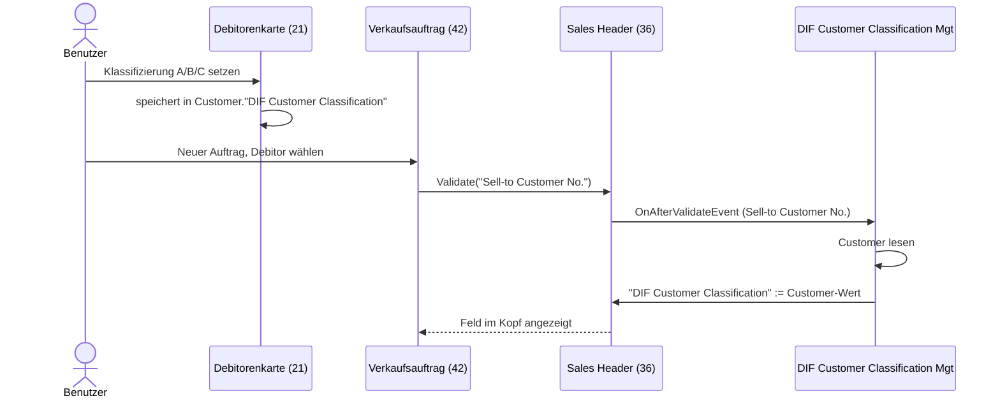
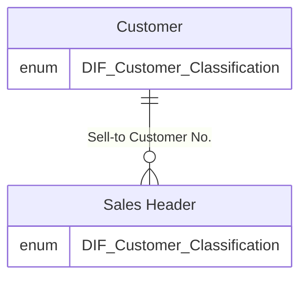

# Konzept Issue #10 – Kundenklassifizierung (A/B/C)

Repo: `Schulungen/_git/DiFFerence.JSChart` (Azure DevOps), App-Ordner `app/`, idRange 50400–50409, Prefix `DIF`.

## 1. Ausgangslage & Ziel
Die App enthält bisher nur eine Chart-Page, keine Tabellen-/Page-Erweiterungen. Gewünscht:
- Neues Feld **„Kundenklassifizierung“** (A/B/C) auf der Debitorenkarte.
- Anzeige in der Debitorenliste.
- Beim Anlegen eines Verkaufsauftrags wird der Wert in den Auftragskopf übernommen.

## 2. Betroffene Objekte
| Typ | ID | Name | neu/Erweiterung | Änderung |
|---|---|---|---|---|
| Enum | 50400 | `DIF Customer Classification` | neu | Werte ` ` (leer), A, B, C; `Extensible = true` |
| TableExtension | 50400 | `DIF Customer Ext` (Tab 18 Customer) | Erweiterung | Feld 50400 `DIF Customer Classification` |
| TableExtension | 50401 | `DIF Sales Header Ext` (Tab 36 Sales Header) | Erweiterung | Feld 50400 `DIF Customer Classification` |
| PageExtension | 50400 | `DIF Customer Card Ext` (Page 21) | Erweiterung | Feld nach „Customer Posting Group“-Bereich (General) |
| PageExtension | 50401 | `DIF Customer List Ext` (Page 22) | Erweiterung | Feld als Spalte, per Default sichtbar |
| PageExtension | 50402 | `DIF Sales Order Ext` (Page 42) | Erweiterung | Feld im Auftragskopf (General), Anzeige |
| Codeunit | 50402 | `DIF Customer Classification Mgt` | neu | Subscriber: Übernahme Debitor → Verkaufskopf |
| PermissionSet | 50400 | `DIFALLPermission` | Erweiterung | Rechte auf neue Objekte |
| Test-App | 50150–50199 | `test/` | neu | siehe Abschnitt 6 |

Entscheidung: **Enum statt Option**, damit erweiterbar und sauber übersetzbar. Leerer Wert erlaubt (Bestandsdebitoren).
Der Wert im Verkaufskopf wird als **Kopie** gespeichert (Snapshot zum Zeitpunkt der Erstellung), nicht als FlowField.

## 3. Ablauf

Datenmodell:

Hinweis: Bei Wechsel des Debitors im bestehenden Auftrag wird der Wert neu übernommen. Nachträgliche Änderung der Debitorenklassifizierung ändert bestehende Aufträge **nicht**.

## 4. UI-Änderungen
- **Debitorenkarte (21):** Feld „Customer Classification“ im Tab „General“, editierbar, ToolTip.
- **Debitorenliste (22):** Spalte „Customer Classification“, sichtbar, ToolTip.
- **Verkaufsauftrag (42):** Feld im Tab „General“, im Kopf; Editierbar bleibt (manuelle Übersteuerung möglich) – siehe offene Fragen.
- Alle Captions/ToolTips Englisch; deutsch: „Kundenklassifizierung“.

## 5. Berechtigungen, Upgrade/Datenmigration
- `DIFALLPermission`: Rechte für Enum/Tabellenerweiterungen/Codeunit (Tabellendaten-Erweiterungen erben die Rechte auf Customer/Sales Header).
- Kein Upgrade-Code nötig: Neues Feld, Default leer. Bestehende Aufträge bleiben leer.
- Es wird kein Abhängigkeitseintrag in `app.json` benötigt (nur Base Application).

## 6. Tests
Test-App `test/` (Abhängigkeiten: Haupt-App, Library Assert, Any, Library Variable Storage, Tests-TestLibraries; idRange 50150–50199). Given-When-Then:
1. Debitor mit Klassifizierung B → neuer Verkaufsauftrag → Kopf enthält B.
2. Debitor ohne Klassifizierung → Kopf leer.
3. Debitor im bestehenden Auftrag wechseln (A → C) → Kopf zeigt C.
4. Klassifizierung am Debitor nachträglich ändern → bestehender Auftrag unverändert.
5. Alle Enum-Werte (A/B/C) werden korrekt gespeichert.
Reine UI-Erweiterungen (Pages) ohne Logik: keine Tests. Ausführung per `al runtests`, sonst manuell über „AL-Testtool“.

## 7. Offene Fragen
1. Soll das Feld im Verkaufsauftrag **editierbar** sein oder nur angezeigt werden?
2. Soll es auch für andere Belegarten (Angebot, Rechnung, Gutschrift) und in die gebuchten Belege (Verkaufslieferung/-rechnung) übernommen werden? Konzept geht zunächst von Sales Header allgemein (alle Belegarten, da Tabelle 36) und **nicht** von gebuchten Belegen aus.
3. Ist ein leerer Wert zulässig oder soll A/B/C Pflichtfeld sein? (Annahme: leer zulässig.)
4. Soll Klassifizierung bei Rechnung-an-Debitor (Bill-to) abweichen können? (Annahme: nur Sell-to.)
5. Exakter Event-Name/Signatur wird bei der Umsetzung per bc-observatory verifiziert (Annahme: `OnAfterValidateEvent` auf `Sell-to Customer No.`; Alternative `OnAfterCopySellToCustomerAddressFieldsFromCustomer`).

## 8. Aufwandsschätzung
**Story Points: 3**

| Phase | Stunden |
|---|---|
| Konzeption | 1,0 |
| Entwicklung (Enum, 2 TableExt, 3 PageExt, Codeunit, Permissions) | 2,5 |
| Tests (Test-App anlegen, 5 Tests) | 2,5 |
| Übersetzung (de-DE xlf) | 0,5 |
| Review/Abnahme/Deploy | 1,0 |
| **Summe** | **7,5 h** |

Annahmen: erfahrene:r BC-Entwickler:in ohne KI, Sandbox verfügbar, Standardverhalten laut offenen Fragen (Annahmen oben), keine Übernahme in gebuchte Belege.
